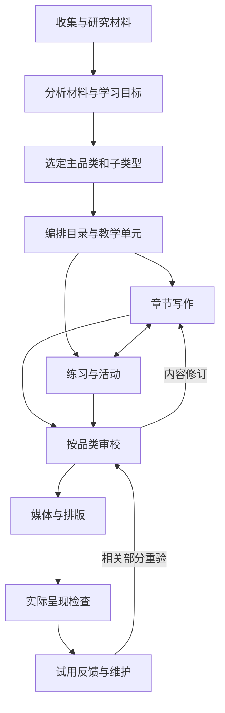

# 中文讲解教材技能集合设计

本轮建议采用 7 个可独立调用的任务 skill，加上按需读取的品类方法资料。先收集教材内容与案例材料，在分析阶段选定具体品类和学习任务，再规划、写作和验证。名称与边界仍是草稿，尚未创建或安装。

这是对早期“6 个入口、先做 3 个”的修订：新增材料研究入口，首批组合调整为研究、策划、写作和审校 4 个。编程与计算机保留为首个验证分支。

2026 年 11 月 19 日修订：根据 musl 教材大纲试用中的用户要求，将实验环境明确为程序教材的必备交付。原设计只提到环境和版本，未说明搭建、自检及章节实验的交付条件；本次补齐这些要求。其他历史阶段描述保留，当前实现状态见[验证记录](../verification.md)。

2026 年 11 月 19 日补充：根据用户要求，将保护注意力与阅读心流纳入共用原则。此前只有正文连贯和主要阅读顺序的要求，未明确非必要旁支的取舍与去向；本次补充策划、写作、审校和排版职责。

## 讲解语言与范围

整个集合只用于编写用中文讲解的教材。正文说明、题目要求、解答分析和图注均用中文。不规划教材翻译、多语种版本或本地化流程，也无需反复询问讲解语言。

教学对象本身使用其他语种时，保留学习所需的原文，并用中文讲解。外来术语、专有名称、代码、命令、接口标识和必要的原文引用按内容需要保留。术语采用通行表达，有助于理解或查阅时附原词，不机械翻译或处处重复双语。

外语教材可以包含目标语言的对话、文章、音频及产出任务；它们属于学习材料。音乐记谱、数学符号和代码同样按学科需要保留。研究资料可以来自其他语种。

## 注意力与阅读心流

教材应保护读者沿当前问题连续理解、推理和操作的过程。非必要不可插入打断主线的碎片式内容，包括与当前任务无关的详细解释、背景考据和引用资料。内容与全书主题有关，不足以成为插入当前段落的理由。

简短出处和补充说明可放脚注，系统性解释安排到相关章节，集中查考资料放附录。正文保留必要标记与简短指引，来源仍可追溯。脚注、边栏和链接同样可能打断阅读，应检查跳转需求，而非只把正文插话搬到旁边。

当前必需的定义、条件、关键步骤和风险提示就地讲清。目标读者略过补充材料后，应仍能完成当前任务。必要的分步说明、预测和练习按教学用途保留，不把一切短内容都判作碎片。

策划确定正文主线与补充材料的位置；写作按当前任务取舍；审校定位打断及缺失的前提；排版检查补充内容的可略过性、查找和返回。正式规则集中在[中文写作约定](../../authoring/references/chinese-writing.md#保护注意力与阅读心流)。这属于本项目的编辑要求，不代表已验证真实读者的心流或学习效果。

## 两个维度如何组合

第一维是用户要完成的工作：收集、规划、写作、出题、审校、排版或维护。它决定调用哪个 skill。

第二维是教材的具体品类与子类型。它决定读取哪些方法、使用什么教学任务，以及如何验证。例如数学证明采用论证检查，工程实验区分预测和测量，外语交际评价信息传达，视觉艺术评价受控观察或作品。

不为每个学科复制一套七阶段入口。先将共用职责保留在任务 skill，将差异写入品类资料。若某类任务以后形成独立流程和工具，例如完整视唱练耳训练或工作室讲评，再依据真实使用需求拆出专项 skill。

## 候选技能及边界

| skill | 独立任务 | 最少输入 | 主要产出 | 边界 |
|---|---|---|---|---|
| `textbook-research` 材料研究 | 搜集、整理、比较教材及教程材料 | 主题或已有材料，已知读者和用途 | 来源清单、内容分析、案例比较、缺口与候选品类 | 未读到正文就不声称做过正文分析；不直接拼成全书 |
| `textbook-plan` 分析与策划 | 选定具体品类，规划范围和编排 | 材料分析或已有充分资料、读者、目标 | 品类决定、任务书、依赖、目录、样章方案 | 先判断再编排；不把候选资料全部塞入目录 |
| `textbook-write` 章节写作 | 写或修改一节、一章、教学单元 | 本次目标、品类、先修和相关材料 | 正文、示例、活动说明、基础自检与必要图解脚本 | 不默认改变整书定位；缺媒体明确标注 |
| `textbook-exercises` 练习与活动 | 出题、实验、交际活动或创作任务 | 目标、内容、读者与实施条件 | 题目或任务、提示、答案或评价依据、目标对应 | 反馈形式由任务决定，不强求唯一答案 |
| `textbook-review` 教材审校 | 检查专业内容、教学或一致性 | 稿件、品类、目标和审查范围 | 定位、证据、影响、修正建议、未验证项 | 只审阅时不改稿；不把模型审查当读者实验 |
| `textbook-layout` 媒体与排版 | 设计图解、组织媒体、制作样张 | 稳定内容、目标载体、资产和样式 | 源文件、实际输出、媒体对应和呈现检查 | 不私自改变目标或发布；不可用文本冒充已验证媒体 |
| `textbook-maintain` 教材维护 | 按版本、勘误或反馈修订 | 现有教材、指定变化及版本条件 | 影响范围、修订、重验及版本说明 | 只处理相关变化；发布和排期按用户请求 |

研究给出候选品类，策划根据目标与材料作出当前决定。两者职责分别是准备证据与作出教学选择，不重复收集一遍。用户已明确品类时沿用，并检查子类型和条件；用户只要研究时停在研究成果。

## 品类方法资料

下列 8 份是规划中的资料模块，不是已实现的 8 个新 skill。普通写章任务只加载共用规则与相关模块，不读取所有学科资料。

| 模块 | 主要选择 | 专有检查 |
|---|---|---|
| 编程与计算机 | 概念机制、方法、算法、项目 | 必备实验环境、搭建与自检、执行轨迹、章节实验、测试与证明边界 |
| 工程 | 分析、实验、设计 | 模型与假设、量纲、图文标记、预测与测量 |
| 数学 | 概念、计算、证明、探究 | 定义、量词、条件、推理、反例及数值近似 |
| 外语 | 交际、听读、语音、写作、查补 | 场景、语言材料、输入输出、媒体、接受多种表达 |
| 视觉艺术与设计 | 感知、制作、分析、设计 | 作品与意图、约束、过程、展示条件和反馈 |
| 音乐 | 理论、分析、听觉、表演 | 谱音对应、风格范围、声音与表现任务 |
| 自然科学 | 模型、观察、实验、数据解释 | 数据身份、证据力度、模型限制和图像尺度 |
| 人文与证据解释 | 细读、史料、比较、论证 | 来源、语境、事实与解释、支持和反证 |

模块内部包含适用条件、可选编排、材料需求、练习反馈、媒体要求、常见失误及案例来源。未研究的子类型明确标记为待补，不因为列入表格就声称已有成熟规则。

通用规则与品类规则发生冲突时，以具体学习目标和必要证据作判断，并写下原因。例如普通示意图应避免只凭颜色区分；但色彩感知活动本身需要保留颜色，并说明替代活动的目标差异。

## 程序教材的实验环境

程序教材必须让读者能够搭建环境、完成自检并重复运行实验。实验环境属于教材交付，不能只用操作系统名称和语言版本代替。根据目标选择一条主要运行路径，核对平台、依赖、权限和观察工具是否支持实验；不统一指定容器、虚拟机或其他工具。

研究阶段收集环境依据与配套资源。策划阶段交付平台与版本方案、搭建路径、材料计划、最小自检及待验证项，并把环境准备安排在首个实验之前。用户只要大纲时停在方案，不擅自实施。

写作与活动阶段提供或引用搭建说明、完整源码和输入、依赖清单、运行命令、观察位置、判断依据及必要的重置方法。审校分别检查环境自检和实验结果的真实记录；维护同步更新受影响的环境材料和实验。

缺少环境或工具时，标记“环境待搭建”或“实验待运行验证”，说明影响与接续步骤，继续独立工作。缺项部分不能称为可完整实施的教材。局部修改沿用已有环境，重验范围由实际影响决定。正式规则集中维护在[编程方法](../../authoring/references/domains/programming.md#实验环境是必备交付)，各技能只保留对应阶段的职责。

## 组合关系

下图是完整的新教材任务，不是每次调用的强制流水线，也不要求使用多个代理。

已有稿件可以直接审校，已有内容可以直接排版。局部任务只补足影响判断的品类与目标信息，不强迫用户重新研究整本书。材料不足时完成有依据的部分，列出缺口；不得用“分类完成”掩盖专业依据不足。

## 项目文件交接

小任务可以在一份文档内记录，整书或多阶段任务才拆为多份。交接依靠项目文件，不依赖聊天记忆。

| 材料 | 最少内容 | 主要维护者 |
|---|---|---|
| 材料清单与分析 | 来源、版本、已读位置、用途、可靠性、内容覆盖、冲突和缺口 | 研究 |
| 品类决定 | 主品类、子类型、辅助品类、读者、学习产出、证据、理由及待定项 | 策划 |
| 教材任务书 | 目标、先修、范围、载体、反馈条件；讲解语言固定为中文 | 策划 |
| 程序教材实验环境 | 平台与版本、搭建说明、实验文件、自检、章节对应、实际状态及必要的重置方法 | 策划确定方案；写作与练习交付；审校核验；维护更新 |
| 章节说明 | 本章目标、依赖、材料、教学结构、活动和反馈 | 写作 |
| 内容约定 | 术语、符号、单位、代码或谱例等适用约定 | 写作；审校检查冲突 |
| 练习与活动包 | 目标、条件、任务、提示、解答或评价依据 | 练习 |
| 媒体资产清单 | 使用位置、源文件、用途、来源、访问条件、替代方式及目标损失 | 写作与排版 |
| 检查记录 | 对象和版本、检查方法、结果、限制 | 执行检查的 skill |
| 修订记录 | 触发原因、修改处、受影响材料、重验结果 | 维护 |

跨文件引用确有需要时使用稳定 ID，不规定题量和章节数。有既定项目约定时沿用。完整的品类决定示例见[材料分析与品类选择](03-材料分析与品类选择.md)。

## 审校中的证据层次

| 层次 | 能支持的判断 | 不能推出的判断 |
|---|---|---|
| 结构检查 | 引用存在、编号一致、材料可定位 | 内容正确或适合读者 |
| 专业检查 | 在声明条件下推理、计算、表达或示例符合相应要求 | 所有场景、传统和版本都成立 |
| 教学审查 | 目标、先修、活动和反馈相互匹配 | 真实读者已经学会 |
| 呈现与媒体检查 | 指定输出可读，媒体内容和对应关系经过实际检查 | 所有设备和访问条件均适用 |
| 读者观察 | 特定参与者在记录条件下的表现 | 普遍学习效果或因果结论 |

审校允许“确认问题”“待核实疑点”和“编辑偏好”分别报告。数学证明不能由运行几个例子验证；口语能力不能由一份书面答案验证；作品评价不能把风格偏好伪装成事实错误。

## 首批实现与依赖

先实现研究、策划、写作、审校 4 个入口，用编程小单元贯通流程，并用其他品类的短任务检查分类是否失误。之后实现练习与排版，在外语和艺术单元中验证媒体要求；最后用实际变更完善维护入口。

各 skill 的必要指令自包含。较长资料按需加载；集合仓库可以维护共同的方法源，打包时必须确保每个入口需要的参考可用，不能硬编码本机路径或暗中依赖另一已安装 skill 的内部文件。具体打包方式在实现阶段决定。

中文写作规范提供语言检查；文档、PDF 或网站工具服务选定载体。教材 skill 负责教学选择和验证要求，不强迫用户使用某个插件。暂不另建总调度 skill，避免增加只转发任务的入口。

设计依据见[跨品类综合](../research/2026-11-18/06-跨品类结论.md)。七项拆分和八份模块是当前可验证方案，不是已证明最优的结构。
